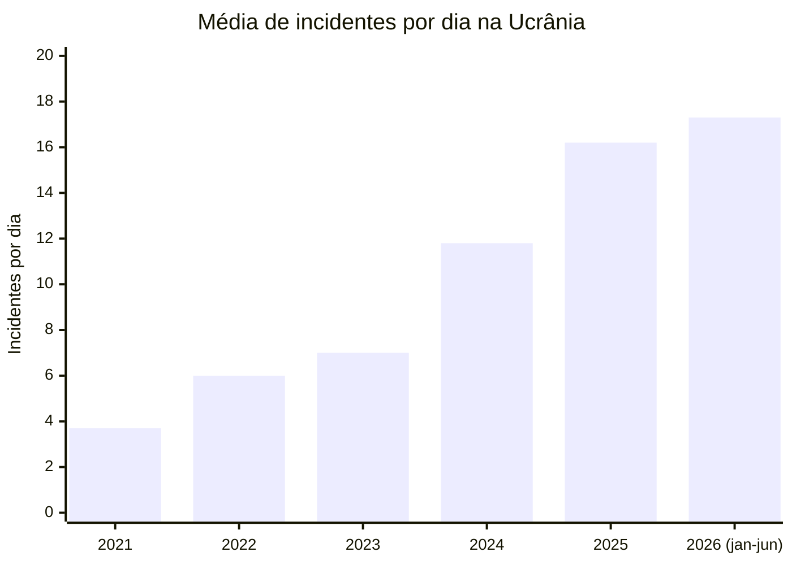
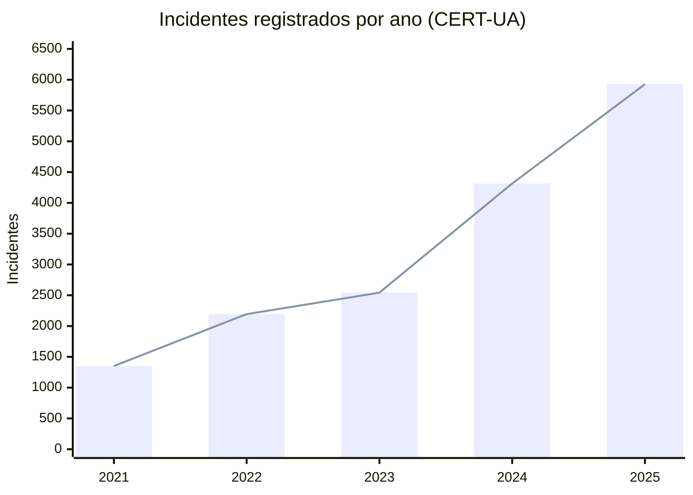

_Cobertura: do episódio mais recente (novembro de 2026) até o início da guerra._
## Resumo

A ciberguerra entre os dois países não substitui os combates com tanques, mísseis e drones. Ela funciona ao lado deles. Os ataques digitais têm efeito **direto** quando atingem comunicações, energia, logística ou produção de armas. Têm efeito **indireto** quando causam pânico, desinformação, desgaste econômico e envolvimento de terceiros. A seguir, a linha do tempo vai do presente ao passado.

## Linha do tempo (do mais recente ao mais antigo)

### Novembro de 2026: aplicativos de alerta hackeados

A força aérea da Ucrânia disse que o aplicativo Air Alert foi comprometido e enviou avisos falsos de ameaça nuclear e química em Kiev e outras regiões. Cerca de duas horas depois, o Ministério russo de Emergências relatou um "ataque cibernético massivo" ao seu próprio aplicativo. Uma mensagem falsa chegou a dizer que o míssil hipersônico Oreshnik havia sido empregado.

O momento importa. Os ataques vieram quando terminou a trégua mais longa da guerra, limitada à região de Kherson. Kiev culpou a Rússia pelo ataque ao seu aplicativo, e Moscou não disse quem estava por trás do seu. Portanto, a autoria ainda não está confirmada.

**Por que isso importa:** um alerta aéreo falso pode fazer a população correr para abrigos sem necessidade. Pior, pode fazer as pessoas **desconfiarem dos alertas verdadeiros**, e isso custa vidas durante bombardeios reais.

### 2025: a Ucrânia ataca a infraestrutura russa

Em 2025 os ataques ucranianos ficaram mais pesados. Alguns exemplos:

- **Aeroflot (28/07/2025):** o ataque, reivindicado pelo grupo ucraniano Silent Crow e pelos Cyber-Partisans de Belarus, paralisou os sistemas da companhia aérea estatal russa e levou ao cancelamento de mais de 100 voos. Segundo relatos, cerca de 7.000 servidores foram destruídos.
- **Ferrovias:** o mesmo grupo teria atrapalhado o tráfego ferroviário ao tomar o controle de semáforos, para dificultar o envio de armamento russo à Ucrânia por Belarus. Esse é um exemplo de efeito direto no campo de batalha.
- **Produção de drones (HUR, junho de 2025):** a inteligência militar ucraniana atacou a Gaskar Integration, grande fornecedora de drones para os militares russos. O HUR obteve mais de 47 terabytes de dados técnicos da produção de drones russos, repassados às Forças Armadas ucranianas.
- **Gazprom e outros:** um ataque à Gazprom bloqueou o acesso aos sistemas internos para quase 20.000 administradores. Em dezembro de 2025, a Ucrânia teria derrubado 700 servidores da gigante logística russa Eltrans+.

### Dezembro de 2023: Kyivstar

O grupo Sandworm, ligado à Rússia, estava dentro da rede da gigante de telecomunicações Kyivstar desde pelo menos maio de 2023. O chefe de cibersegurança do SBU afirmou que o ataque não teve grande impacto sobre as forças armadas, que não dependiam das operadoras de telefonia. O efeito principal foi sobre os civis: serviços de telefonia e internet fora do ar para milhões de pessoas.

### 2023: ciberataque somado a ataque físico

Durante um ataque de mísseis na Crimeia ocupada, o IT Army da Ucrânia derrubou provedores de internet que supostamente forneciam imagens de câmeras às forças russas, dificultando a defesa. Aqui o ciberataque serviu diretamente a uma operação militar.

### Abril de 2022: Industroyer2

O malware Industroyer2 foi usado numa tentativa de ataque contra uma empresa de energia ucraniana na noite de 8 de abril de 2022. Ele foi neutralizado antes de causar efeito. Se tivesse funcionado, teria provocado apagões em larga escala.

### 24 de fevereiro de 2022: Viasat KA-SAT

No dia da invasão, vários modems da rede de satélites KA-SAT, da Viasat, pararam de funcionar por causa de um malware destrutivo ("wiper") chamado AcidRain. Os atacantes entraram por uma configuração incorreta num equipamento de VPN e chegaram ao segmento de gerenciamento da rede. Essa rede era muito usada pelo exército e pela polícia da Ucrânia.

O efeito colateral foi enorme: o controle remoto de cerca de 5.800 turbinas eólicas na Alemanha foi desativado. Isso mostra que ciberataques não respeitam fronteiras.

### Janeiro e fevereiro de 2022: o preâmbulo

Em 14 de janeiro de 2022, um ataque derrubou mais de uma dúzia de sites do governo ucraniano. Em 15 de fevereiro, outro ataque derrubou serviços do governo e de bancos. O IT Army of Ukraine, um grupo de voluntários para operações ofensivas, foi criado em 26 de fevereiro de 2022.

### Antes da guerra: o histórico

Os primeiros ataques cibernéticos russos registrados contra a Ucrânia ocorreram durante os protestos de 2013. O pior incidente cibernético na Ucrânia antes da invasão foi o NotPetya, em 2017, que atingiu os setores financeiro e energético. A Ucrânia virou um laboratório de ciberguerra muito antes de 2022.

## Influência direta e indireta

**Efeitos diretos (afetam o combate em si):**

- Interrupção das comunicações militares, como no caso Viasat.
- Sabotagem da logística, como ferrovias e empresas de transporte.
- Roubo de dados de produção de armamentos, como no caso dos drones.
- Apoio a operações físicas, como a derrubada de câmeras na Crimeia.

**Efeitos indiretos (afetam a capacidade de lutar):**

- **Psicológico e informacional:** alertas falsos de radiação ou de mísseis geram medo e desconfiança no governo.
- **Econômico:** a paralisia de companhias aéreas, empresas de energia ou logística custa milhões e desgasta o esforço de guerra.
- **Civil:** ataques a telecomunicações e a serviços públicos afetam a população, e não só os soldados.
- **Geopolítico:** os efeitos transbordam para países terceiros, como a Alemanha no caso da Viasat, e fortalecem a cooperação ocidental em defesa cibernética.
Vou procurar dados oficiais de incidentes para o gráfico não ficar com números inventados.

# Gráfico da média de incidentes cibernéticos

## Antes de tudo, o que os dados mostram ?

Só consegui dados oficiais do lado **ucraniano**. A Rússia não publica estatísticas comparáveis, então um gráfico "entre Ucrânia e Rússia" seria inventado. Este gráfico mostra os **incidentes registrados pelo CERT-UA**, a equipe nacional de resposta a incidentes da Ucrânia.

Os números anuais são estes:

- **2021 a 2024:** 1.350 (2021), 2.194 (2022), 2.543 (2023) e 4.315 (2024).
- **2025:** a equipe tratou 5.927 incidentes, 37,4% a mais que no ano anterior.
- **1º semestre de 2026:** 3.137 incidentes, 8% a mais que no segundo semestre de 2025.

A **média por dia** é um cálculo meu: total do período dividido pelo número de dias.
## Média diária de incidentes cibernéticos (CERT-UA)

## Total anual de incidentes

| Período | Total de incidentes | Média por dia | Média por mês |
|---|---|---|---|
| 2021 | 1.350 | 3,7 | 112 |
| 2022 | 2.194 | 6,0 | 183 |
| 2023 | 2.543 | 7,0 | 212 |
| 2024 | 4.315 | 11,8 | 360 |
| 2025 | 5.927 | 16,2 | 494 |
| 2026 (jan-jun) | 3.137 | 17,3 | 523 |

*Fonte: CERT-UA / SSSCIP. Médias calculadas dividindo o total pelos dias do período.*

_Observação: muitas reivindicações de ataques vêm dos próprios grupos que os realizam, e os governos nem sempre confirmam. Vale tratar números e autoria com cautela._
## Cuidados ao interpretar

- **"Incidente" não é o mesmo que "ataque".** O CERT-UA conta casos que sua equipe tratou. Em 2022, por exemplo, os sistemas automáticos registraram cerca de 7.000 incidentes, muito além dos 2.194 tratados manualmente. O número real de ataques é bem maior.
- **O aumento não é só mais ataques.** A própria equipe explica que o crescimento está ligado à intensidade dos ataques e também à maior capacidade de detectá-los.
- **Mais incidentes não significa mais gravidade.** Os incidentes críticos e altos eram 48% do total em 2022, caíram para 14% em 2023 e chegaram a 1% em 2024. A guerra digital ficou mais frequente, mas menos destrutiva em cada caso.
- **Alguns números divergem entre fontes.** Uma delas cita 1.042 incidentes em 2024, mas parece contar só uma parte dos casos. Usei a série oficial da SSSCIP, que é a mais consistente.
## Conclusão

A lição mais clara é que o ciberataque raramente decide a guerra sozinho. O caso Kyivstar mostra isso: a Ucrânia continuou lutando mesmo com a telefonia civil atingida. Por outro lado, quando o ataque digital se combina com uma ação física, como no caso da Crimeia, ou atinge a cadeia de suprimentos, como nas ferrovias e na produção de drones, o efeito é concreto. A fase atual, com ataques a sistemas de alerta, aposta na confusão e na confiança da população, e não na destruição de equipamentos.

